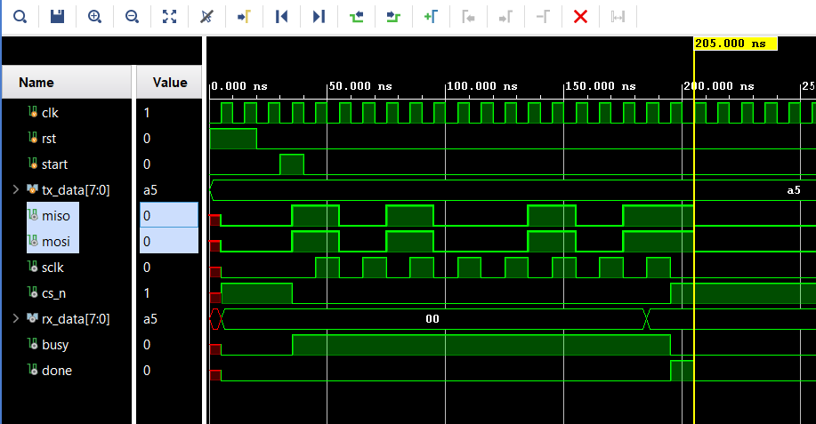

# SPI master (Verilog)

A simple SPI master module written in Verilog as a learning project. Runs in mode 0, 8-bit transfers, MSB first. FSM: IDLE → TRANSFER → FINISH.

## Structure

## Files
- `spi.v` — the module
- `echo_tb.v` — loopback testbench (`miso` tied to `mosi`)

## Waveform

